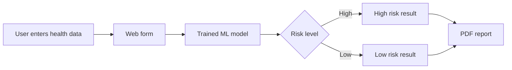

<div align="center">

# 🫀 Heart Disease Prediction System

**Enter your health details, get an instant risk prediction and a downloadable PDF report**


<!--  -->

</div>

---

## 📖 Overview

The **Heart Disease Prediction System** is a web application that estimates a patient's **risk of heart disease**. The user fills in a form with clinical details such as **blood pressure, cholesterol, blood sugar and chest pain type**. A machine learning model then classifies the patient as **high risk** or **low risk**, and the app generates a **PDF report** of the result.

> ⚠️ **Disclaimer:** This project is for educational purposes only. It is not a medical device and must not be used as a substitute for professional medical advice, diagnosis or treatment.

## ✨ Features

- 📝 Simple form for entering patient health parameters
- 🤖 ML-based **high / low risk** prediction
- 📄 **Auto-generated PDF report** that the user can download
- 🌐 Clean, easy-to-use web interface

## 🔄 How It Works



## 📋 Input Parameters

| Parameter | Description |
|---|---|
| Age / Sex | Basic patient information |
| Blood pressure | Resting blood pressure |
| Cholesterol | Serum cholesterol level |
| Blood sugar | Fasting blood sugar |
| Chest pain type | Type of chest pain experienced |
| [Other fields] | _Add any other inputs your form uses_ |

## 🧠 Model

| Item | Details |
|---|---|
| Dataset | [e.g., UCI Heart Disease dataset] |
| Algorithm | [e.g., Logistic Regression / Random Forest] |
| Accuracy | [ADD ACCURACY, e.g., 85%] |

## 🛠️ Tech Stack

| Layer | Technology |
|---|---|
| Frontend | HTML, CSS |
| Backend | Python ([Flask / other]) |
| ML | [scikit-learn / other] |
| Reports | [PDF library, e.g., ReportLab / FPDF] |

## 🚀 Getting Started

### Prerequisites

- Python 3.8+

### Installation

```bash
git clone https://github.com/Kashiish134/Heart_Disease_prediction_system.git
cd Heart_Disease_prediction_system
pip install -r requirements.txt
```

### Run the app

```bash
python app.py
```

Then open `http://127.0.0.1:5000` in your browser.

> ✏️ Change `app.py` and the port if your project uses a different entry file.


## 🔭 Future Improvements

- [ ] Compare multiple ML models and show their accuracy
- [ ] Add charts showing which factors contributed most to the result
- [ ] Deploy online (Render / Streamlit / Hugging Face Spaces)
- [ ] Save patient history for repeated check-ups

## 👩‍💻 Author

**Kashish Aggarwal**
[GitHub](https://github.com/Kashiish134) · [LinkedIn](https://www.linkedin.com/in/kashish-aggarwal-kashish-aggarwal)

⭐ If you found this project useful, consider giving it a star!
